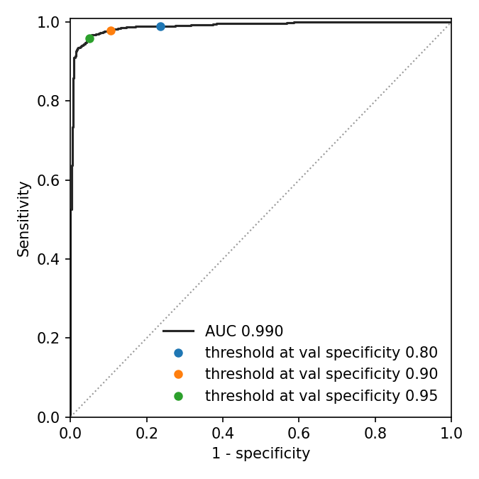
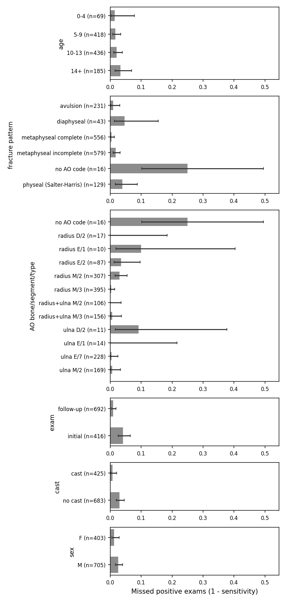

# Pediatric wrist fracture detection, evaluated per patient and per exam

A YOLO11 detector trained on [GRAZPEDWRI-DX](https://doi.org/10.1038/s41597-022-01328-z) (20,327 radiographs, 10,699 exams, 6,091 children). The architecture is standard on purpose. The work is in the evaluation: a split by patient, exam-level sensitivity at a specificity fixed on a separate validation set, confidence intervals, an analysis of missed fractures by age and AO type, and a small inference service packaged with Docker.

## Why the protocol matters on this dataset

A child contributes on average 3.3 images: an AP and a lateral view per exam, and often several follow-up exams of the same fracture while it heals. The baseline published with the dataset splits images at random, which puts the same patient, and frequently the same fracture, on both sides of the split. Here patients are assigned to train, validation or test as a whole, and the pipeline fails if any patient appears in two splits.

mAP ranks boxes over all images. A radiologist or an emergency physician gets one answer per exam, at one threshold. The main metric is therefore the sensitivity of the exam-level decision at a specificity of 80, 90 and 95 %, with the threshold chosen on validation and applied once to the test set.

## Protocol

**Split.** 70 / 15 / 15 % of patients, stratified on whether the patient has any fracture box and on the age band at the first visit. Seed 42.

**Preprocessing.** The 16-bit PNGs are windowed between the 0.5th and 99.5th intensity percentiles, converted to 8 bits and resized to 1024 px on the longest side. The API uses the same function, so a DICOM sent to the service goes through the same transform as the training images.

**Model.** YOLO11s pretrained on COCO, 1024 px input, the 9 annotated classes. Augmentation: mosaic, horizontal flip, rotation up to 5°, scale ±30 %, brightness only (hue and saturation carry nothing on grayscale images). Cosine learning rate, early stopping on validation mAP.

**Exam level.** An exam groups the images of one patient sharing a study number. Its score is the highest fracture confidence over its images; it is positive when at least one image has a fracture box. Confidence intervals come from 2,000 bootstrap resamples of patients, not images, so that correlated exams of the same child are resampled together. Results are reported on all exams, on initial and follow-up exams separately, without the exams tagged `diagnosis_uncertain`, on the exams that have two views, and at image level.

**Lesion level.** FROC curve and sensitivity at 0.25 to 2 false positives per image. A predicted box matches a fracture when IoU ≥ 0.3: the dataset paper reports a median inter-reader IoU of 0.73 on fracture boxes but a 1st percentile of 0.22, so 0.5 would count as misses boxes that two radiologists would both accept.

**Leakage control.** The same model is trained again on two leaky splits and evaluated the same way: a random split of images (`pedwri.resplit --unit image`), and a random split of exams (`--unit exam`), which keeps the views of an exam together but lets the other exams of a child, often follow-ups of the same fracture, fall in train. Both re-use the converted images through symlinks. The split by image leaves most test exams with a single view, which makes them harder and hides the effect of the leak, so the split by exam is the fair comparison. Within its test set, `pedwri.seen` also compares the exams of children who have other exams in train with those of unseen children, with the same model and threshold.

**Errors.** At the 90 % specificity threshold: missed exams by age band, AO fracture pattern (metaphyseal incomplete or complete, physeal, avulsion), initial or follow-up exam and cast; missed boxes by size and projection; false positives among negative exams, including exams that carry an AO code without any fracture box, where the reference label itself is questionable.

## Results

`pedwri.evaluate` writes the tables to `results/results.md` and the figures to `results/`; `pedwri.errors` writes the subgroup analysis to `results/errors/`.

Test set: 1593 exams from 914 patients, 1108 with at least one fracture box.

| Subgroup | Exams | AUC |
|---|---|---|
| all | 1593 | 0.990 (0.985-0.994) |
| initial_exam | 876 | 0.984 (0.976-0.991) |
| follow_up | 717 | 0.976 (0.946-0.993) |
| certain_labels | 1554 | 0.993 (0.989-0.996) |
| two_views | 1396 | 0.990 (0.985-0.994) |

Image level: AUC 0.989 (0.984-0.992) on 3015 images, 2017 with a fracture box.

| Operating point (val) | Threshold | Sensitivity | Specificity | PPV | NPV |
|---|---|---|---|---|---|
| spec_0.80 | 0.025 | 0.989 (0.983-0.995) | 0.765 (0.720-0.809) | 0.906 (0.884-0.926) | 0.969 (0.950-0.984) |
| spec_0.90 | 0.142 | 0.979 (0.970-0.987) | 0.895 (0.861-0.927) | 0.955 (0.940-0.970) | 0.950 (0.928-0.968) |
| spec_0.95 | 0.488 | 0.958 (0.945-0.970) | 0.951 (0.929-0.971) | 0.978 (0.968-0.987) | 0.909 (0.881-0.935) |

| Specificity on the test ROC | Sensitivity |
|---|---|
| 0.80 | 0.989 |
| 0.90 | 0.977 |
| 0.95 | 0.961 |

Lesion level (2683 fracture boxes, IoU >= 0.3):

| FP per image | Sensitivity |
|---|---|
| 0.25 | 0.958 |
| 0.5 | 0.975 |
| 1.0 | 0.984 |
| 2.0 | 0.988 |





At the 90 % specificity threshold, 17 of 416 positive initial exams are missed against 6 of 692 positive follow-ups. False positives concentrate on negative exams under a cast (7 of 11) and on negative exams that carry an AO code without any fracture box (10 of 17).

The leaky splits (`results_image_split/`, `results_exam_split/`) give:

| Split | Test exams | Exam AUC | Two-view exams AUC | Image AUC | Sensitivity, spec_0.90 |
|---|---|---|---|---|---|
| patient | 1593 | 0.990 (0.985-0.994) | 0.990 (0.985-0.994) | 0.989 (0.984-0.992) | 0.979 (0.970-0.987) |
| exam | 1605 | 0.989 (0.983-0.993) | 0.989 (0.983-0.993) | 0.988 (0.983-0.992) | 0.985 (0.977-0.992) |
| image | 2830 | 0.985 (0.981-0.989) | 0.994 (0.986-0.998) | 0.986 (0.982-0.989) | 0.973 (0.965-0.980) |

Test exams of patients with other exams in train (seen) or not (unseen), threshold spec_0.90 (0.085).

| Exams | n | Positive | AUC | Sensitivity | Specificity |
|---|---|---|---|---|---|
| seen | 862 | 742 | 0.986 (0.973-0.996) | 0.993 (0.987-0.999) | 0.842 (0.758-0.912) |
| unseen | 743 | 378 | 0.984 (0.975-0.991) | 0.968 (0.949-0.985) | 0.923 (0.894-0.949) |
| seen, initial exams | 251 | 148 | 0.994 (0.986-0.999) | 0.980 (0.953-1.000) | 0.922 (0.867-0.969) |
| unseen, initial exams | 620 | 260 | 0.981 (0.969-0.991) | 0.962 (0.938-0.983) | 0.928 (0.899-0.953) |

On this dataset the patient leak inflates the figures very little. The split by exam and the split by patient give the same exam-level AUC within the confidence intervals, and the sensitivity at the 90 % specificity operating point moves from 0.979 to 0.985. Among initial exams, children already seen in train reach an AUC of 0.994 (0.986-0.999) against 0.981 (0.969-0.991) for unseen children, with overlapping intervals. Over all exams the seen group is mostly follow-ups, nearly all positive, which raises sensitivity and lowers specificity at a fixed threshold rather than reflecting memorisation. The detection task is close to saturation here, which leaves little room for a leak to show.

## Reproducing

```bash
pip install -e ".[train]"
python -m pedwri.download --out data/raw
python -m pedwri.prepare --root data/raw --out data/prepared
python -m pedwri.train --data data/prepared
python -m pedwri.predict --weights runs/yolo11s_1024/weights/best.pt --data data/prepared --out predictions
python -m pedwri.evaluate --data data/prepared --pred-dir predictions --out results
python -m pedwri.errors --results results --images data/prepared/images/test
```

The leakage control repeats training and evaluation on a re-split copy, then compares seen and unseen children:

```bash
python -m pedwri.resplit --data data/prepared --out data/prepared_exam_split --unit exam
python -m pedwri.train --data data/prepared_exam_split --name yolo11s_1024_exam_split
python -m pedwri.predict --weights runs/yolo11s_1024_exam_split/weights/best.pt --data data/prepared_exam_split --out predictions_exam_split
python -m pedwri.evaluate --data data/prepared_exam_split --pred-dir predictions_exam_split --out results_exam_split
python -m pedwri.seen --data data/prepared_exam_split --results results_exam_split
```

The notebooks in `notebooks/` run the same steps on Kaggle: `kaggle_prepare.ipynb` downloads and converts the data on CPU, `kaggle_train.ipynb` takes its output as input and trains, evaluates and exports on a single GPU, and `kaggle_leakage.ipynb` runs a leaky split (`UNIT = "exam"` or `"image"`). The Kaggle notebooks first copy the prepared data to local disk, since reading images from the mounted input slows training several times.

The tests run the whole pipeline (preparation, split checks, re-splits, evaluation, error analysis, API) on a synthetic dataset with the same file layout:

```bash
pip install -e ".[dev]"
pytest
```

## Inference service

```bash
python -m pedwri.export --weights runs/yolo11s_1024/weights/best.pt --out models
cp results/operating_points.json models/
docker build -t pedwri .
docker run -p 8000:8000 pedwri
```

```bash
curl -X POST localhost:8000/predict -F "files=@ap.png" -F "files=@lateral.dcm"
```

All images posted together are treated as one exam. PNG, JPEG (8 or 16 bit) and uncompressed DICOM are accepted; MONOCHROME1 DICOMs are inverted. The response contains the boxes in original pixel coordinates, a score per image, the exam score and the decision at the operating point set by `PEDWRI_OPERATING_POINT` (`spec_0.80`, `spec_0.90` or `spec_0.95`). Inference runs on CPU through ONNX Runtime, without PyTorch in the image.

## Limitations

- One hospital, ten years of acquisitions. Nothing here says how the model behaves on another centre's equipment or population.
- Two thirds of the images contain a fracture, far above the prevalence in an emergency department. Sensitivity and specificity transfer; PPV and NPV do not.
- AO codes are attached to images, not to boxes. When an image holds several fractures, the type of each box is ambiguous, so the analysis by type is done per exam.
- Ages are given in whole years and exams are reconstructed from file names.
- Research prototype, not a medical device.

## Data

Nagy E, Janisch M, Hržić F, Sorantin E, Tschauner S. A pediatric wrist trauma X-ray dataset (GRAZPEDWRI-DX) for machine learning. *Scientific Data* 9, 222 (2022). Licensed CC BY 4.0.
